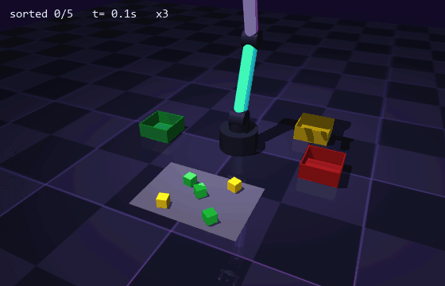

# YOINK

> A robot that looks at a messy table, finds every cube, and yoinks it into the bin of its color.
> Vision from scratch, grasping with real friction physics, zero machine-learning magic. Just geometry doing numbers.



*Top right is what the robot actually sees: its RGB-D camera, with the cubes it detected boxed and their estimated rotation. Sped up 3x. Every cube is held by two fingers and friction. No teleporting, no welding the cube to the gripper, no cap.*

---

## TL;DR

- **Perception from scratch**: HSV color masks, connected components, RGB-D back-projection to 3D and a minimum-area-rectangle fit for position and yaw. No OpenCV, no neural nets.
- **0.2 mm average position error** and **0 missed cubes** out of 200 on random tables.
- **Real grasping**: a two-finger gripper with slide joints squeezes the cube, and MuJoCo friction does the rest.
- **810 out of 810 cubes sorted** over 200 held-out episodes, every one on the first grab.
- Built on top of [ARMageddon](https://github.com/nonberw/armageddon), my from-scratch IK library. Project 2 of the series.

## The pipeline

```
 RGB-D camera ──> color masks ──> blobs ──> 3D points ──> top face ──> min-area rect ──> cube pose
                                                                                            │
 bin of its color <── open <── carry <── lift <── squeeze <── descend <── approach <────────┘
```

The robot parks out of the camera's way, takes a picture, picks the closest cube, sorts it, and looks again. Looking again after every pick is the cheap way to be robust: if a cube got nudged, the next picture already knows.

## How it works

**1. Seeing in 3D.** The camera gives color and metric depth for every pixel. With focal length $f$ (from MuJoCo's vertical field of view) and principal point $(c_x, c_y)$, a pixel $(u, v)$ at depth $d$ becomes a point in the camera frame:

$$x = \frac{u + \tfrac12 - c_x}{f}\,d, \qquad y = -\frac{v + \tfrac12 - c_y}{f}\,d, \qquad z = -d$$

and then world coordinates via the camera pose, $p_w = p_{cam} + R_{cam}\,[x, y, z]^\top$. The tests check that projecting and back-projecting round-trips to 1e-9.

**2. Finding the cubes.** Convert RGB to HSV and threshold the hue around each cube color, with saturation and brightness floors so the dark floor and the grey mat never sneak in. Then label 8-connected blobs (plain BFS, written by hand).

Fun bug: the top face of the yellow cube is so brightly lit that its brightness clips at 100%, and clipped yellow drifts toward 60 deg of hue. With a tight threshold the robot saw only the sides of yellow cubes and was 14 mm off. Moving the yellow hue window took that error down to 0.3 mm.

**3. Filtering in 3D, not in 2D.** Every blob pixel gets back-projected, and only points that are actually on the table at cube height survive. That one line kills false positives from the colored bins, the arm and reflections. Turns out it's easier to filter in the world than in the image.

**4. Pose from the top face.** Keep the highest points (the top face), then fit the minimum-area enclosing rectangle: sweep angles at 1 deg, refine at 0.05 deg. Its center gives $x, y$, the face height gives $z$, its angle gives the yaw. A cube looks identical every 90 deg, so yaw lives in $[0, 90)$ and the grasp picks whichever equivalent angle keeps the wrist least twisted.

**5. Touching cubes.** Two same-colored cubes that touch merge into one blob, and the robot happily aims at the gap between them. Fix: if the top face is wider than one cube can be, split it with 2-means seeded at its two extreme points, and recurse. A single cube's minimum-area rectangle is 40 mm on each side no matter how it's rotated, so anything wider than 50 mm has to be more than one cube.

**6. Moving.** Joint-space moves for the long trips (IK solved once with restarts, then min-jerk interpolation between joint vectors), straight Cartesian lines for the precise parts (descend, lift), with warm-started IK at 60 Hz. Position motors plus gravity compensation make the arm follow. The min-jerk profile $s(\tau) = 10\tau^3 - 15\tau^4 + 6\tau^5$ has zero velocity and acceleration at both ends, so nothing jerks the cube out of the fingers.

**7. Grasping.** The fingers are commanded to close *past* the cube's width, so the position motors keep squeezing with a constant force. Elliptic friction cones and pads with a friction coefficient of 1.5 hold a 50 g cube without slipping.

**8. Not overfilling bins.** The first version dropped every cube on the same spot. With five reds in one episode, the pile grew, and the next drop shoved cubes over the wall. Now each bin fills corner by corner.

## Results

### Perception

`python scripts/perception_benchmark.py`, on random tables from seeds I never touched while debugging:

| Metric | Value |
|---|---|
| Cubes | 200 on 40 random tables |
| Detected / missed / false positives | 200 / 0 / 0 |
| Position error, mean / p95 / max | 0.20 / 0.45 / 0.72 mm |
| Yaw error, mean / max | 0.05 / 1.13 deg |
| Detection time per frame (640x480, pure Python) | 236 ms |

Sub-millimeter error means the camera, the math and the filtering are all doing their job. The 236 ms is the hand-written BFS in pure Python. It's the obvious next thing to vectorize, but the robot only takes one picture per cube, so it isn't the bottleneck.

### Sorting

`python scripts/evaluate.py --episodes 200`, held-out seeds, 3 to 5 cubes per episode, random positions, rotations and colors:

| Metric | Value |
|---|---|
| Episodes | 200 (3-5 cubes each, 810 cubes total) |
| Cubes sorted into the right bin | 810/810 (100%) |
| Episodes with every cube sorted | 200/200 (100%) |
| Pick attempts per cube | 1.00 |
| Sim time per cube | 7.4 s |
| IK misses during straight-line moves | 0 |
| Wall time | 563 s (0.69 s per cube) |

**The honest breakdown:**

- It wasn't always 100%. The first version scored **98.8%** (407/412) on my debugging seeds. All 5 misses traced back to two real bugs: touching same-colored cubes merging into one blob, and an overfilled bin spitting cubes back out. Both fixes are described above. The table is from a fresh set of seeds I never debugged on, so it isn't the result of tuning for the test.
- 0 failures out of 810 doesn't mean "never fails". By the rule of three, the true failure rate is below about 3/810, roughly **0.4%**, with 95% confidence. Good, not magic.
- Where it would break: cubes stacked on or hiding behind each other (the layout keeps them apart), noisy real depth, and lighting that moves the hues. That's the roadmap.
- One more bug that never made it into the robot's score: creating a fresh OpenGL renderer per episode crashed the evaluation after ~150 episodes on Windows. Now each scene size compiles one model and keeps one camera.

## Running it

```bash
pip install -r requirements.txt
```

Watch it sort a random table in real time:

```bash
python scripts/play.py --cubes 5
```

Tests, benchmarks and the GIF:

```bash
python -m pytest
```

```bash
python scripts/evaluate.py --episodes 200
```

```bash
python scripts/perception_benchmark.py
```

```bash
python scripts/render_gif.py
```

## What's where

```
yoink/
  scene.py        # MuJoCo scene: arm + parallel gripper, cubes, bins, RGB-D camera
  camera.py       # pinhole model, depth rendering, (back-)projection
  perception.py   # HSV masks, connected components, min-area rect, touching-cube split
  motion.py       # min-jerk moves, IK every tick, gravity compensation, gripper
  task.py         # the look -> pick -> place loop
scripts/
  play.py                  # live viewer
  evaluate.py              # sorting success over many episodes
  perception_benchmark.py  # detection accuracy vs ground truth
  render_gif.py            # the GIF at the top
tests/            # perception, geometry and a full end-to-end episode
```

## Roadmap

Part of a "physical AI from scratch" series:

- [x] [ARMageddon](https://github.com/nonberw/armageddon): IK, Jacobians, control
- [x] **YOINK**: vision-based pick-and-place
- [ ] Imitation learning: train a neural policy from demonstrations
- [ ] RL locomotion: teach a quadruped to walk and not fall over when kicked
- [ ] Sim-to-real on an actual SO-101 arm

Ideas for YOINK itself: cluttered piles where cubes occlude each other, unknown object shapes (point-cloud grasp planning instead of "it's a cube"), and noisy depth like a real RealSense.

## FAQ

**Why not just use a neural network for detection?**
Because for colored cubes, a neural net is a sledgehammer for a thumbtack. The classical pipeline gets 0.2 mm error, explains itself, and runs without a GPU. Knowing when *not* to reach for deep learning is also a skill.

**Isn't the simulation cheating?**
Partly, and that's fine to admit: the depth is perfect and the lighting is fixed. What isn't cheating is the grasp. The cube is only held by finger friction, so a bad grasp actually drops it.

**Why YOINK?**
That's the sound the robot would make if it could.

## License

[MIT](LICENSE)
